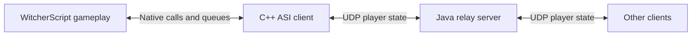

# Witcher Online: developer overview

This guide describes the source in this checkout. It is based on static inspection; the mod has not been built or tested in-game for this documentation.

## How it works

Witcher Online adds a multiplayer layer to each player's local Witcher 3 game. Each client gathers its player's state, sends it to a Java relay server, and creates local actors representing other players. The server does not run a Witcher world simulation.



Movement, appearance, combat animations, chat, emotes, riding, trading, Gwent, and party coordination are implemented in the client scripts. Parties can synchronize time, weather, and dialogue selections. **NPCs, quest progress, and general world state are not synchronized**: players retain separate saves and local worlds. Combat presentation sync should not be treated as shared NPC combat or an authoritative damage system.

## Repository map

Paths below are relative to the repository root. The script directory is `witcher/mods/modWitcherOnline/content/scripts/`.

| Location | Responsibility |
| --- | --- |
| `local/anno.ws` | Adds and wraps game methods: creates the multiplayer client, starts it on player spawn, and hooks menus, input, dialogue, and gameplay events. |
| `local/client.ws` | Main `r_MultiplayerClient` state machine; outgoing state collection, inbound updates, remote-player lifecycle, parties, trading, Gwent, chat, and emote commands. Start here for most gameplay changes. |
| `local/remotePlayer.ws` | `r_RemotePlayer`: replicated state and behavior for another player, including its local ghost actor. |
| `local/ghostPlayer.ws` | `MPDRPlayer`, a `CNewNPC` subclass used for remote-player actors. |
| `local/trade.ws`, `local/hashmap.ws` | Trade UI helpers and player lookup structures. |
| `game/gui/menus/gwintManager.ws`, `gwintGameMenu.ws` | Gwent integration. |
| `sharedutils/` | Map pins and on-screen text utilities. |
| `client/dllmain.cpp` | Native plugin startup, XML configuration, UDP workers, packet encoding, chunk reassembly, sequences, and transport watchdog. |
| `client/NativeBridge.cpp`, `NativeBridge.h` | Native function registration and queues between WitcherScript and networking. |
| `server/src/WitcherServer.java` | UDP sessions and broadcasting, console administration, IP bans/whitelist, and optional HTTP status endpoints. |
| `server/src/PlayerSession.java` | Player ID, endpoint, last-seen timestamp, and latest update chunks. |
| `witcher/mods/`, `witcher/dlc/` | Installable game content, including packed assets and localized strings. `.bundle` files use Git LFS. |

## Runtime and protocol

1. The ASI plugin initializes, reads configuration, registers native functions through WitcherNativeBridge, and starts UDP sender/receiver threads.
2. `anno.ws` exposes `theGame.r_getMultiplayerClient()`. The player spawn hook starts the script tick state.
3. Each frame, `wo_tickEntry()` calls `WO_PumpTransport()` and updates remote actors and gameplay features. `WO_Tick()` supplies a scheduling bitmask; scripts gather only the requested state groups.
4. Scripts call `WO_Send()` to enqueue payloads. C++ converts them into escaped, tab-separated UTF-8 UDP packets. The wire header carries an opcode, player ID, and username; remaining fields depend on the opcode.
5. The server manages sessions from incoming updates. It forwards `MOVE` immediately and rebroadcasts cached update chunks approximately every 100 ms to all connected endpoints, including the sender. It removes inactive sessions after five seconds and reserves timed-out usernames for their IP for another 60 seconds.
6. C++ processes incoming packets, combines matching update halves, and queues messages. Scripts consume them through `WO_Poll()`, `WO_Str()`, and `WO_NameAt()`, then apply them to `r_RemotePlayer` objects and render the corresponding actors.

| Script payload | UDP opcode | Main purpose |
| --- | --- | --- |
| `move` | `MOVE` | Frequent movement and region data. |
| `wo` | `UPDATE1A`, `UPDATE1B` | General player/gameplay state, including movement context, animation, combat, chat, and interaction data. |
| `wo2` | `UPDATE2A`, `UPDATE2B` | Appearance and customization state. |
| `wo3` | `UPDATE3` | Gwent requests, bets, seed, deck/action data. |
| `wo4` | `UPDATE4` | Party membership, time/weather, dialogue, and related state. |

The positional schema lives in `wo_get1()` through `wo_get4()` and `WO_ApplyUpdate1()` through `WO_ApplyUpdate4()` in `local/client.ws`, plus the parsers in `client/dllmain.cpp`. Update halves use sequence tracking. UDP provides no delivery guarantee, so a new one-shot action needs explicit deduplication and delivery handling; repeated state broadcasts alone do not make transactions reliable.

## Where to extend it

- **Local mechanics, UI, roleplay, or emotes:** start in `local/client.ws`, add game hooks in `local/anno.ws` where necessary, and extend `local/remotePlayer.ws` when other players need to display the result.
- **New shared state:** update the script serializer and matching inbound field indexes together. Check C++ parsing, field counts, split boundaries, and sequence handling. The server mostly relays opaque field lists, but new opcodes require server acceptance, caching/broadcast behavior, native decoding, and script dispatch changes. Keep clients and server on compatible schemas.
- **Shared objectives or a custom game mode:** introduce an explicit session/objective model and define who owns state and awards rewards. The existing party system can coordinate players, but does not replicate quest completion or provide server-owned progression.
- **Shared NPCs or authoritative combat:** this requires a new replication system with entity IDs, ownership, spawn/despawn, AI and damage rules, and reconciliation. The current player ghosts are only a starting point for presentation.
- **Economy or persistent rewards:** add server validation, persistence, and idempotent transactions. The existing relay stores player updates in memory and is not an authoritative inventory or account service.

A practical first extension is a small party activity: show an objective locally, replicate its status, and display it for party members. Test with two clients, then verify late joining, reconnecting, duplicate/out-of-order updates, and region changes before adding progression or rewards.

## Building and running

**Native client:** open `client/MultiplayerClient.sln` in Visual Studio with the v143 C++ toolset and Windows SDK. The x64 configurations use C++17 and produce `WitcherOnlineClient.asi`. Override the hard-coded GOG `OutDir` in `MultiplayerClient.vcxproj` for your installation or a staging directory. ASIO is a Git submodule; pugixml and the WitcherNativeBridge header/import library are included. The matching WitcherNativeBridge runtime and a working ASI loading setup are external runtime prerequisites; their implementation is not supplied here.

**Server:** the Java sources use the JDK standard library; no Maven or Gradle build is included. With JDK 17 or newer, a basic build/run from the repository root is:

```powershell
New-Item -ItemType Directory -Force server/out
javac -d server/out server/src/*.java
java -cp server/out WitcherServer 40000
```

These are suggested commands, not a verified build. The default game port is UDP `40000`. `server.properties`, `banned-players.json`, and `whitelisted-players.json` are resolved beside the running classes/JAR (for the commands above, `server/out/`). Properties include `port`, `whitelist`, `svgEnabled`, and `svgPort`. Optional status serving defaults to TCP `40001` and exposes `/status.svg`, `/players.svg`, and `/status.json`. Type `help` in the server console for administration commands.

**Game content:** deploy the contents of `witcher/` into the game installation, alongside the required mod dependencies and native runtime. Script references include Custom Player Characters (`NR_*`) and Chill Out behavior; this checkout is not a complete dependency installer. Review the supplied `input.xml.txt` and `input.settings.txt` when integrating input bindings. Packed content changes require a separate Witcher asset toolchain; no automated asset build pipeline is included here.

**Client configuration:** the native code resolves `WitcherOnline/config.xml` under the parent of the executable directory (normally the game's `bin/WitcherOnline/`). It writes `WitcherOnline.log` there too. For a local server:

```xml
<Config>
  <Username>Developer</Username>
  <ServerIP>127.0.0.1</ServerIP>
  <Port>40000</Port>
</Config>
```

Use a different username for each client. Usernames are sanitized to letters, digits, and underscores and capped at 16 characters. The source falls back to a hard-coded public endpoint if configuration is absent, so set the endpoint explicitly for development.

No project-specific automated test suite or CI configuration was found outside vendored dependencies. In-game testing remains necessary for script compilation, native ABI compatibility, and multiplayer behavior. See the repository's `LICENSE` for its GPLv3 terms.
